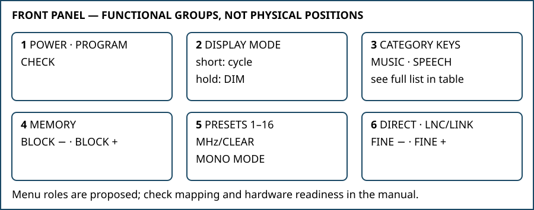
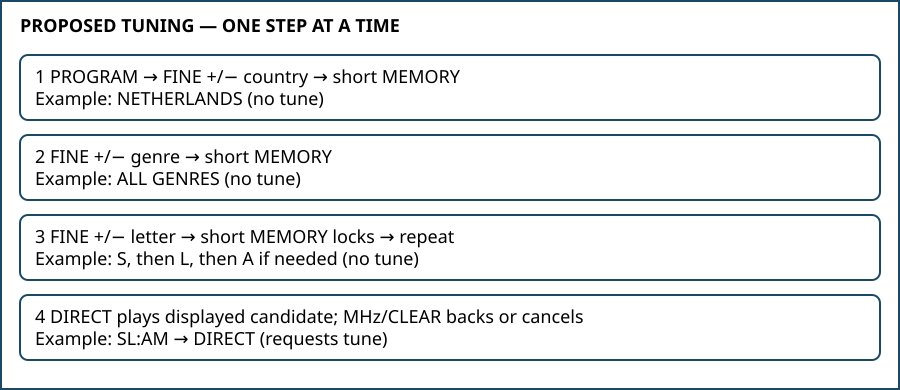

# Internet-radio menu: user instruction manual (planned)

> **Not available in current firmware.** This manual describes the proposed
> menu, not controls you can use on the installed 0.3.48 front panel.
> The PROGRAM switch, DIRECT and FINE +/− still need verified controller mappings.
> Directory browsing, country selection, Top 10 and holding MEMORY to save
> are not implemented. Recording the last station and restoring brightness and
> display mode from a status file are target requirements, not installed features.
> See the [program guide](16-internet-radio-menu-program-guide.md)
> for recommendations and unresolved decisions.

For controls that work now, use the
[screen-driver operating guide](13-screen-driver-operating-guide.md) and
[current front-panel status](15-split-setup-architecture.md#portable-controller--travel-demo).
The controller still plays radio locally; split-audio station control is a target.

## What this manual promises

The target is operation on the original Sony front panel: no web interface,
phone app or IR remote should be required to operate the receiver. AirPlay
must still be **initiated on the sending device**. Receiver status, disconnect
and source policy are intended to be available on the Sony. This is a
proposal, not approval of any new key mapping or evidence that it works today.

Today preset **assignments** and bench setup still use web configuration;
these are gaps, not instructions for the target experience. Physical
onboarding and recovery for network credentials, and adding a station outside
the directory, remain undesigned. The original headphone LEVEL control is
visible on the panel; whether any other volume, mute or standby function is
already supported by the actual Sony hardware must be verified. No new
front-panel method for these functions is promised here.

## Quick start (target)

With the network and directory already set up, and the display safely running:

1. Press a numbered **1–16** key to recall a preset; an unassigned slot leaves
   playback alone. This recall exists today, subject to keypad reliability.
2. To find something else, press **UNDEFINED** to open the proposed country
   selector, then use **FINE +/−** and short **MEMORY** to choose a
   country and genre, or a category key to open its Top 10.
   In Top 10, FINE moves between candidates; to search by name, move to
   **BROWSE ALL** and short press MEMORY. Browsing does not tune.
3. Use **FINE +/−** and short **MEMORY** to narrow a station name, then
   **DIRECT** to request playback of the displayed candidate. Use
   **MHz/CLEAR** to back out. These menu actions are not implemented yet.
4. To save a candidate instead, hold **MEMORY**, choose a number and confirm
   replacement if needed. Saving does not tune it.

Each example below is a separate single-row display, at most **22 characters**,
not several lines shown simultaneously. Names and messages are illustrative;
exact presentation and several mappings remain open.

## Front-panel control map and evidence

### Front panel: numbered controls

[Editable drawing source](media/internet-radio-front-panel.excalidraw) ·
[View full-size drawing](media/internet-radio-front-panel.svg)

The drawing follows the group layout in the
[reference photograph](media/image1.jpeg), but is simplified and not a
dimensioned facsimile. The numbers are **callouts**, not preset numbers.
Descriptions below distinguish current actions from proposals; see the
evidence table immediately after them for individual-key reliability.

| No. | Control | Explanation |
| --- | --- | --- |
| 1 | POWER | Original power control. Its physical mapping to the new controller is unverified; do not assume it provides a new software standby function. |
| 2 | PROGRAM OFF / SET / ON | Switch: proposed ON starts NPO Radio 2 or the programmed station; OFF starts the tuner without a preset loaded; SET enables programming the startup station with CHECK. Controller mapping remains unverified. Not a country-menu button. |
| 3 | CHECK | Currently starts Stereo VU only from stopped, when hardware is ready; does not change a running scan. Proposed: short press forces Wi-Fi reconnect and checks cross-ESP communications; in PROGRAM SET, hold for two seconds to store the startup station. |
| 4 | DISPLAY MODE | Currently a short press starts or cycles display modes to OFF; a hold changes DIM once while a radio scan runs. Starting requires hardware readiness. |
| 5 | Display | Single row of 22 character cells with separate indicators. Menu messages and AirPlay status in this manual are proposals. |
| 6 | DIRECT | Proposed to request playback of the displayed station candidate; physical mapping is unverified. |
| 7 | LNC / LINK | The photo appears to say LNC; other documentation says LINK. Key identity and any occupied function need verification. A Source menu is only a possible future use. |
| 8 | PHONES | Original headphone socket, not a keypad button. |
| 9 | LEVEL | Original headphone-level knob, not a keypad button. Other volume or mute support has not been established. |
| 10 | Category and MUSIC / SPEECH keys; UNDEFINED | Proposed category shortcuts open a country-filtered Top 10 without tuning. UNDEFINED is instead proposed to open the country selector. All physical labels are shown in the drawing and listed in the evidence table below; their mappings have differing confidence. |
| 11 | MEMORY | Raw events only today. Proposed: short press confirms or advances; hold with a valid station candidate enters preset storage. |
| 12 | BLOCK − / + | Raw events only today. Proposed: jump six countries or six alphabet positions, depending on context. |
| 13 | Presets 1–16 | Current numbered recall; unassigned slots leave playback unchanged. Proposed: select the destination during preset storage. Keys 8 and 16 need continued reliability observation. |
| 14 | MHz/CLEAR | Raw event only today; proposed back or cancel, including cancelling a pending preset replacement. |
| 15 | MONO MODE | Raw mapping has been intermittent; no current action. Reserved as a possible future real mono/stereo option, not assigned here. |
| 16 | FINE TUNING − / + | Proposed to move through choices or edit the active letter; physical mappings remain unverified. |

### Mapping evidence by key

[Editable control map source](media/internet-radio-control-map.excalidraw)

This is a **functional diagram**, not a physical facsimile. The
[reference photograph](media/image1.jpeg) shows the groups around the display,
including the left POWER and PROGRAM controls, category block below the
display, MEMORY/BLOCK centrally, numbered keys, and right-hand controls.
It appears to label the right-hand key **LNC**; the virtual-panel guide calls
it **LINK**. The LNC display annunciator is separately documented in
[bus observations](05-bus-capture-findings.md); neither that annunciator nor
the spelling proves the physical key's matrix identity. Confirm the label and
mapping on the actual unit before relying on either name.

In the table, **current** means implemented action, not proof every switch
is reliable; **raw** means a captured matrix event without an implemented
action; **proposed** means only the chapter 16 menu design. The
[keypad retests](14-keypad-mapping.md) are the authority for raw evidence.
An ordered run alone can misassociate keys if an event is lost.

| Map | Physical label(s) | Evidence and action |
| --- | --- | --- |
| 1 | POWER; PROGRAM (OFF/SET/ON); CHECK | POWER and PROGRAM controller mappings are unverified. PROGRAM is a switch with the proposed startup behavior above, not a country-selector button. CHECK is mapped and currently starts Stereo VU only when stopped and hardware ready; it does nothing to a running scan. Proposed replacement actions are described under [Check connections](#check-connections-proposed). |
| 2 | DISPLAY MODE | Current: short press starts Now Playing when stopped or cycles modes to OFF; hold cycles DIM once while a radio scan runs, without a second short action on release. Starting requires hardware readiness. |
| 3 | NEWS, VARIED | Raw events individually retested clean; proposed category shortcuts. No current category action. |
| 3 | DRAMA, CULTURE, CLASSICS, OTHER M | Raw events individually retested clean; proposed category shortcuts. No current category action. |
| 3 | AFFAIRS, INFO, SPORT, EDUCATE, POP M, ROCK M, M.O.R. M, LIGHT M | Raw associations from an ordered run only; individually verify before use. Proposed category shortcuts, not current actions. ROCK M is also recorded as ROCKM. |
| 3 | SCIENCE, UNDEFINED | Raw shared-column mappings are intermittent: latest complete retest was clean, but earlier tests produced whole-row events. SCIENCE is a proposed category shortcut; UNDEFINED is now proposed for country selection instead of its earlier category role. Neither action exists today. |
| 3 | MUSIC, SPEECH | Raw events clean in later individual checks; proposed category shortcuts, not current actions. The BALANCE marking over these keys does not establish additional separate buttons or a current balance function. |
| 4 | MEMORY; BLOCK +; BLOCK − | Raw only today. MEMORY and BLOCK+ were individually observed, including rapid repeat pairs; BLOCK− shares the intermittent column. Proposed short MEMORY confirms, hold stores a candidate; BLOCK jumps six countries or six letters, depending on context. |
| 5 | 1–16 | Current immediate preset recall; proposed destination selection only during storage. The latest shared-column test was clean for 8 and 16, but both previously produced row-wide events and 8 also produced simultaneous columns; continued observation is needed. Other tested keys were clean, but not every key was individually retested in the latest checks. |
| 5 | MHz/CLEAR; MONO MODE | MHz/CLEAR: raw event retested clean; proposed back/cancel. MONO MODE: raw only, shared-column intermittent despite latest clean pair; no current action. |
| 6 | DIRECT; LNC/LINK; FINE −, FINE + | Physical mappings unverified; virtual controls are disabled. DIRECT and FINE have proposed tuning/navigation roles. LNC/LINK has no approved menu assignment; its physical identity and lack of an occupied function must be verified. |

The currently **unallocated** controls in the chapter 16 menu design are
LNC/LINK and MONO MODE; this is a design inventory, **not** a claim of clean
physical mappings. Earlier notes also mention BALANCE MUSIC/SPEECH, but the
photo does not establish separate balance keys; MUSIC and SPEECH are already
proposed category controls. POWER is not a spare menu key, and UNDEFINED is
now proposed for country selection. Do not repurpose
presets, DIM, or country/back/commit gestures. The separately requested CHECK
change below replaces its existing function only in the proposal. If verified and truly
unoccupied, LNC/LINK is a restrained candidate for a Source menu; MONO MODE
can remain reserved for a future real mono/stereo option. Leave ambiguous
controls reserved rather than assigning last-station, sleep-timer or other
features merely because a key appears free.

## Tuning at a glance (proposed)

[Editable tuning flow source](media/internet-radio-tuning-flow.excalidraw)

In words: UNDEFINED → FINE +/− → short MEMORY for country → FINE +/− →
short MEMORY for genre → FINE +/− and short MEMORY to edit the prefix →
DIRECT on the candidate. At each step MHz/CLEAR backs out as described below.
Only DIRECT requests a tune; all preceding steps leave playback unchanged.

## Before using the planned menu

These walkthroughs assume a future implementation and an already safely
authorized, running display. **The menu must not start a stopped display.**
Selecting a station or preset does not authorize physical output.
Follow chapter 13's connection/isolation precautions; Sony OFF alone is not
electrical isolation. No hardware work is requested by this manual.

Browsing does not interrupt the current station. Only DIRECT on a station
candidate or an explicit numbered preset recall requests a new station.
Menu screens temporarily cover, then return to, your chosen display mode
without changing DIM brightness or safety authorization.

## Check connections (proposed)

The requested target action for **CHECK** is a forced Wi-Fi reconnect and
validation of communications between the controller ESP and audio ESP.
This would **replace** CHECK's current short-press Stereo VU start action;
there is no approved replacement gesture for that VU start yet. It is not
implemented in the installed firmware, where CHECK still works as described
in chapter 13. DISPLAY MODE remains unchanged.

After a future short CHECK press, the receiver should reconnect the relevant
Wi-Fi connection or connections using the existing saved settings, then
perform a bounded, matched request/reply check of the cross-ESP link.
Show separate results such as `WIFI RECONNECT`, `WIFI OK`, `WIFI ERROR`,
`ESP LINK OK`, or `ESP LINK ERROR`, followed by the prior display mode.
An unavailable or timed-out audio ESP must not be reported as a successful
link, and a link response alone does not prove audio playback or Internet
service. The split design needs to decide how to initiate and report a
reconnect on each ESP, including when the inter-ESP link is unavailable.
The existing diagnostic PING/PONG is not a complete verified exchange;
do not use the isolated-bench MAP command for this check.

Forcing reconnection can interrupt current streaming or AirPlay. A failed
check must report the affected connection and allow a later CHECK retry; it
must not erase credentials, presets or the saved station, choose a fallback
station, or implicitly authorize/start a stopped physical display. Network
credential setup and recovery still require a separately designed physical
flow.

### PROGRAM switch and CHECK hold (proposed)

1. Select the radio station you want to hear after power-up.
2. Move PROGRAM to **SET** and hold **CHECK for two seconds** to store that
   station as the programmed startup station. This is separate from saving a
   numbered preset and must not itself retune playback. A short CHECK press
   remains the proposed connection check; a completed hold must not also
   dispatch that short action on release.
3. Move PROGRAM to **ON**. At the next power-up, start the programmed station
   or, if none has been programmed, **NPO Radio 2**. With PROGRAM **OFF**,
   start the tuner without loading a preset.

The storage implementation and exact success/error prompts remain to be
designed. A failed write must be reported and must preserve any previously
programmed station; do not claim a save succeeded prematurely. Behavior at
power-up while the switch is left in SET is undecided. This startup behavior
and the CHECK hold are proposals, not installed features.

## What startup must remember (planned)

The proposed system must keep a **persistent status file** with your last-used
station, chosen brightness and display mode. Restore the logical brightness
and display mode, but do not automatically resume the last-used station in
contradiction to the PROGRAM switch behavior above. The programmed startup
station is not assumed to be the last-used station. If a selected startup
station fails, show the error without silently choosing another station.
You can explicitly select a different station.

Only intentional successful changes are saved: a station you explicitly select
and successfully play, a display-mode choice (including OFF), or a brightness
change. Browsing, saving a candidate as a preset, loading animations, menu
screens and announcements must not replace those saved settings.
Restoring settings does not start stopped physical display output or restore
hardware authorization. OFF retains your brightness for later use.

The policy for a missing/corrupt file or first boot is still undecided; NPO
Radio 2 is the requested ON startup choice, not a fallback after failure.
Country-filter persistence is separately
**undecided**, unlike the three required saved settings above.

## Choose Netherlands, then a genre

Planned sequence:

1. Press **UNDEFINED** to open countries. Its mapping is intermittent and
   this entry action is not implemented. The proposed country indicator blinks while you choose;
   the previous applied country remains in force until confirmation.
2. Use **FINE +/−** to move one country, or **BLOCK +/−** to move six entries.
   Find `NETHERLANDS`.
3. Briefly press **MEMORY** to apply it and open genres. The earlier proposal
   keeps the PROGRAM display label lit; its suitability now needs confirmation.
4. Use **FINE +/−** to choose a genre. Choose `ALL GENRES` for no genre limit.
   Briefly press **MEMORY** to open alphabetical station browsing.
5. Press **MHz/CLEAR** to go back one level. Returning from genres or stations
   does not clear Netherlands.

For example, the consecutive screens may read `NETHERLANDS`, `ALL GENRES`,
then an alphabetical candidate. To narrow by genre instead, select the
desired genre with FINE and short MEMORY. The country is not applied until
the first short MEMORY; neither choice changes playback.

“Country” here means station location, not the Country music genre.
The selected country applies to browsing and category shortcuts even while
a station plays. Whether it survives reboot is **not decided**.

## Use a category's Top 10

With Netherlands applied, press **ROCK M** (also called ROCKM), **NEWS**,
**MUSIC**, **SPEECH**, **SCIENCE** or another category button.
The proposed shortcut opens that category under the selected country, replacing
the previous genre criterion; this replacement rule still needs approval.

- Use **FINE +/−** to move through up to ten station candidates.
  Here +/− changes stations, not genres or letters.
- Press **DIRECT** to play the displayed station. Opening the list does not
  play it or assign presets automatically.
- To search beyond the shortlist, move to **BROWSE ALL** after the candidates
  and briefly press **MEMORY**. It keeps the same country/category.
- Fewer than ten may be available. No matches must be reported explicitly;
  there is no silent switch to worldwide results.

Recommended ranking is directory-recorded clicks in the last 24 hours,
**not audience ratings**. Final ranking is not yet decided.
For example, `TOP10 ROCK M` → candidate → `BROWSE ALL` → short MEMORY
opens the full filtered browser without changing playback. MHz/CLEAR returns
to the prior browse/playback screen from Top 10, or to Top 10 from an empty
prefix in the full browser.

## Find SLAM without spelling the entire name

This example assumes SLAM is available in the chosen country/genre.
You may use ALL GENRES first if the current category excludes it.

1. In alphabetical station browsing, use **FINE +/−** to choose **S**.
   The active letter blinks and the first matching station is suggested.
2. Briefly press **MEMORY** to lock S and move to the second character.
3. Use **FINE +/−** to choose **L**, then briefly press MEMORY to lock SL
   and move to the third position. Choose A if needed to display SLAM.
4. Press **DIRECT** whenever SLAM is the displayed candidate.
   You do not have to finish spelling it; S or SL may also match other stations.

In this screen **BLOCK +/− jumps six alphabet positions**, for example B → H
with BLOCK+, not six stations. Recommended behavior skips empty prefixes
with FINE; BLOCK first jumps six letters, then searches onward in that
direction if the target has no matches. Wrap, digits and non-Latin names
still need design decisions.

Recommended back/edit control: **MHz/CLEAR**, not LINK/LNC. It goes back one
character; at an empty prefix it returns to the originating genre or Top 10 list.

The physical display has just one row of 22 characters. A proposed display
convention is `SL:AM`: SL is locked, A is the blinking editable character and
M is the suggested suffix. The exact visual convention is not finalized.
The cursor must remain visible rather than scrolling away.

## Save, replace or cancel a preset

Planned storage sequence, with a station candidate selected:

1. **Hold MEMORY** until `STORE PRESET --` appears. The required hold duration
   is not decided. Releasing must not also perform the short-press action.
2. Press **1–16** to choose a slot. An empty slot saves the selected station.
3. For an occupied slot, e.g. 7, read `REPLACE PRESET 07?`.
   Briefly press **MEMORY** to confirm replacement.
4. Before committing a save, press **MHz/CLEAR** to cancel without changing
   any presets. Once a write has been committed, cancellation cannot undo it.
5. Wait for `STORED`, which must mean the persistent save succeeded.
   `SAVE ERROR` means it did not succeed; the previous preset must remain intact.

Storing must not tune the candidate or overwrite other slots.
While choosing a storage slot, numbered keys choose the destination; they
do not recall stations. Outside storage, they retain immediate preset recall.

## Recall a preset

Numbered preset recall already exists; the planned menu must preserve it:

- Press **1–16** outside storage to recall that saved station.
- An unassigned slot briefly shows `Unassigned` and leaves playback unchanged.
- Assigned slots show `Preset X`, then loading until connection, then the
  station identifier for about two seconds before returning to your display mode.
  In the existing layout, `Preset` is in cells 4–9, cell 10 is blank and the
  number is in cells 11–12.
- Recall never starts stopped physical display output.

For example, short press **7** outside storage: `Preset 7` → loading →
station name after connection. An empty slot shows `Unassigned` and does not
change playback; a connection failure is reported rather than silently
tuning another station.

The proposal stores a directory station's UUID, name and last-known playable
URL so a saved preset can play without a working directory service. The stream
itself still needs network access. The recommended rule lets you recall a
preset from another country without changing or being blocked by your browse
filter. A failed station must show an error, never silently play a replacement.

## Clear or cancel the country filter

To browse worldwide, press **UNDEFINED**, select **ALL COUNTRIES** and briefly
press **MEMORY**. Genre selection opens; the earlier indicator proposal turns
the PROGRAM display label off, subject to confirmation.
ALL COUNTRIES removes only the location restriction; ALL GENRES separately
removes the genre restriction.

To abandon a pending country change, press **MHz/CLEAR** instead of MEMORY.
The previous applied country and its light state return. Merely highlighting
ALL COUNTRIES does not clear a filter.

Recommended non-disruptive rule: changing or clearing the browse-country filter
does not stop the station already playing.

## Quick reference

All menu meanings below are planned unless explicitly marked existing.

| Control or indicator | Meaning |
| --- | --- |
| PROGRAM switch | Proposed ON: start NPO Radio 2 or the programmed station; OFF: start without a loaded preset; SET: hold CHECK to store the startup station. Controller mapping remains unverified |
| UNDEFINED | Proposed country-selector entry; shared-column mapping remains intermittent |
| FINE +/− | Country list: one entry; genre list: one genre; Top 10: candidate; station editor: active letter |
| BLOCK +/− | Countries: six entries; station editor: six alphabet positions |
| Short MEMORY | Confirm country/genre, lock a letter, open BROWSE ALL, or confirm preset replacement |
| Hold MEMORY | Enter storage for the selected station; not assigned in country/genre lists |
| DIRECT | Play the currently displayed station candidate, without spelling its full name |
| MHz/CLEAR | Cancel/back; does not implicitly clear the applied country |
| 1–16 | Existing immediate recall, except planned slot selection while storing |
| DISPLAY MODE | Existing mode cycle including OFF; hold changes DIM |
| CHECK | Current: start Stereo VU only when stopped and hardware ready. Proposed: short press forces Wi-Fi reconnect and checks cross-ESP communications; in PROGRAM SET, hold two seconds to store the startup station |

The earlier proposed PROGRAM country light is the **display label**, not the
physical switch or separate PROGRAM 1/2/3 digits; its suitability needs
confirmation. Current VU modes may use digits for level warnings.
The logical country reminder must not turn a stopped display on.

## Loading and problems

The planned browser must distinguish loading, incomplete/stale cached results,
no matches and a directory error. Allow loading to finish or use the eventual
retry/refresh control (its exact gesture remains undecided); you can back out
with MHz/CLEAR. A partially loaded list is not proof there are no other matches.
Directory problems must not erase presets or interrupt the current station.

For example, `LOADING` may be followed by `NO MATCHES` or `DIRECTORY ERROR`;
a stale or incomplete cache must be identified as such. Back out with
MHz/CLEAR and retry/refresh once its physical gesture is designed; there is
no specified retry key today. For `SAVE ERROR`, the old slot remains intact:
cancel with MHz/CLEAR or retry the save when the eventual implementation
allows it. On a stream connection error, explicitly choose another station or
retry when a physical retry control is specified. Network setup/recovery
itself has no designed physical flow yet. None of these failures selects a
fallback station or authorizes a stopped display.

Only supported direct **HTTP/HTTPS MP3/AAC** streams are in scope.
A directory page/API address or station website is not a playable stream.
This design adds no HLS or playlist support. A directory listing is not a
guarantee that a station can connect or decode.

## AirPlay and source control (proposal only)

The [radio profile](firmware/README-RADIO.md) explicitly says the DAR profile
does **not** start AirPlay or Sony mute/relay/PCM-I2S controls. Inherited
standalone behavior is not confirmation of support on the DAR target. Actual
sender discovery, session release and playback require implementation and
physical testing. Initiate AirPlay on the sender; the following is the
proposed local receiver experience, not a current control.

On the Sony, show the active playback owner and state, for example
`RADIO PLAYING`, `AIRPLAY PLAYING` or `AIRPLAY PAUSED`. A paused AirPlay
session still owns playback. Show the sender-reported device name, scrolling
it within the 22 cells if necessary; if unavailable show `UNKNOWN DEVICE`.
That is different from `NO AIRPLAY SESSION`: do not invent a device name
or confuse an unknown sender with no session.

If LNC/LINK is verified and has no occupied function, propose it as the
entry to a local Source menu. Within that menu only, use FINE +/− to choose
an item and short MEMORY to select/confirm; MHz/CLEAR backs out or cancels.
These contextual roles do not alter the country, browser or preset gestures.

1. Select `DISCONNECT` and short MEMORY; show `DISCONNECT?`.
2. Short MEMORY again explicitly confirms; MHz/CLEAR cancels without changing
   the session. A confirmed disconnect releases the **actual receiver session**,
   not merely mute or pause, and returns to the selected radio station. A
   queued selection during AirPlay is the selected radio station. If connection
   fails, show the error, not another station.
3. Disconnect alone does not prevent the sender immediately retaking playback.
   Separately choose `RADIO ONLY` and confirm with short MEMORY to block
   AirPlay retake. Choose `AUTO` / `AIRPLAY ALLOWED` and confirm to permit it
   again. MHz/CLEAR cancels either pending policy change.

Changing source policy must not change the saved station, erase presets, or
start a stopped display. The policy's persistence across reboot remains an
open decision. If no spare key is verified, a read-only AirPlay status item
in the existing DISPLAY MODE cycle is a possible physical fallback; it must
preserve the existing short cycle and DIM hold. It does **not** provide
disconnect or policy commands: a safe, verified physical entry for those
commands still needs design and hardware validation. No currently unused
gesture is claimed safe.
